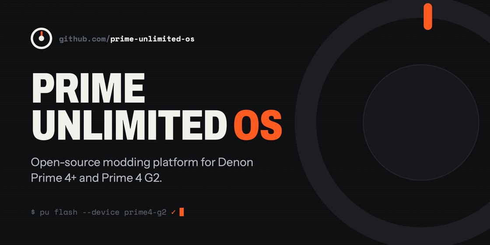

<div align="center">



**Open-source modding platform for Denon DJ Prime 4+ and Prime 4 G2.**

</div>

Prime-Unlimited OS is a cross-platform desktop foundation for safely bootstrapping SSH and managing compatible mods on supported Denon DJ controllers.

> **Development status:** the application supports guided setup, read-only diagnostics, and SSH key preparation. Hardware writing is deliberately disabled. The repository does not yet contain the confirmed identities, licensed payloads, or tested recovery procedures required for production flashing.

## Supported devices (in development)

| Device | Hardware profile | Initial USB transport | SSH after setup |
|---|---|---|---|
| Denon DJ Prime 4+ | JC11S | Fastboot | Port 22 |
| Denon DJ Prime 4 G2 | JP24 | imbupd | Port 2222 |

## Implemented

- Polished PySide6 desktop wizard with manual Prime 4+ (JC11S) and Prime 4 G2 (JP24) selection.
- Separate read-only Fastboot and imbupd diagnostic paths with fail-closed writers.
- Explicit handling for absent, wrong, multiple, ambiguous, and unverified devices.
- Mandatory passphrase-protected Ed25519 generation or existing key-pair validation.
- Host-key-pinned SSH verification service.
- SHA-256 package validation and a strict mod manifest model with device/firmware compatibility and rollback declarations.
- Secret-redacting diagnostics and persistent non-sensitive window settings.
- Hardware-independent unit tests and PyInstaller configuration.

## Run locally

Python 3.12 or newer is required. Create and activate a virtual environment, then run:

```sh
python -m venv .venv
# Windows PowerShell: .venv\Scripts\Activate.ps1
# Windows Command Prompt: .venv\Scripts\activate.bat
# macOS: source .venv/bin/activate
python -m pip install -e .
python -m app.main
```

## Tests

```sh
python -m pip install -e .[dev]
pytest
```

Ordinary tests use fixtures and mocks and never require a controller.

## Packaging

Install development dependencies, then build on each target operating system:

```sh
pyinstaller packaging/prime-unlimited-os.spec
```

Sign and notarize release artifacts using project-controlled credentials. Credentials must never be committed.

## Hardware blockers

- **JC11S:** the exact positive Fastboot model identifier, independently reproduced bootstrap, redistributable payload, and proven backup/recovery procedure remain unavailable.
- **JP24:** read-only hardware inspection confirmed USB descriptors `DENON DJ` / `PRIME 4 G2`, VID:PID `15e4:d014`, and the expected imbupd interface. The protocol query returned version `1.4.2` and mains power; `product` and `serial` were not found. The module accepts the exact descriptor pair with a successful protocol query. A verified `/data` backup and recovery procedure remains missing, so production writing is blocked.
- A USB command reporting success is insufficient. Completion will require normal device operation and an authenticated, host-key-verified SSH session on port 22 (JC11S) or 2222 (JP24).

See the [bootstrap specification](docs/BOOTSTRAP_SPEC.md), [device selection flow](docs/DEVICE_SELECTION.md), and [JC11S technical record](docs/JC11S_PROCESS.md).

## Disclaimer

Unofficial community project. Not affiliated with or endorsed by Denon DJ or inMusic.
