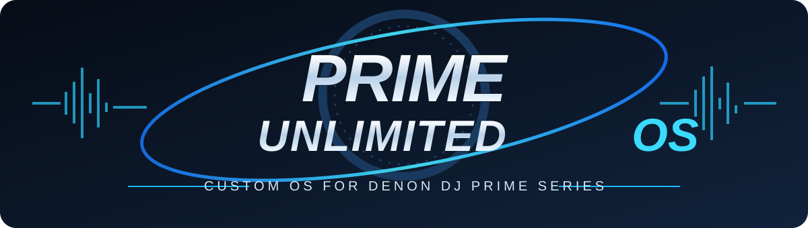

**Open-source modding platform for Denon DJ Prime 4+ and Prime 4 G2.**

## Supported devices (in development)

| Device | Hardware profile | Initial USB transport | SSH after setup |
|---|---|---|---|
| Denon DJ Prime 4+ | JC11S | Fastboot | Port 22 |
| Denon DJ Prime 4 G2 | JP24 | imbupd | Port 2222 |

## Project goals

- Guided Windows and macOS installer with **manual device selection**
- Mandatory SSH setup during the initial USB bootstrap
- Device-specific installation and safety checks
- SSH/SFTP-based mod management after initial setup
- Planned mods: DOOM and USB Copy to SSD

## Status

🚧 **Early development — not ready for installation.** No production-ready installer or validated recovery procedure is available yet.

See the [bootstrap specification](docs/BOOTSTRAP_SPEC.md), [device selection flow](docs/DEVICE_SELECTION.md), and [JC11S technical record](docs/JC11S_PROCESS.md).

## Disclaimer

Unofficial community project. Not affiliated with or endorsed by Denon DJ or inMusic.
